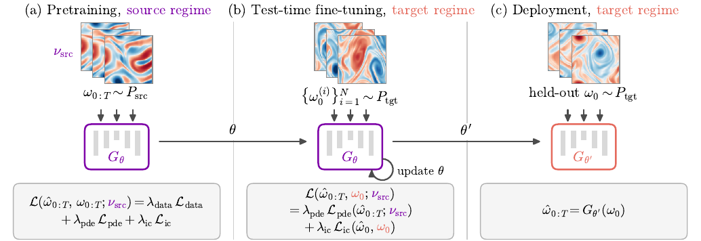
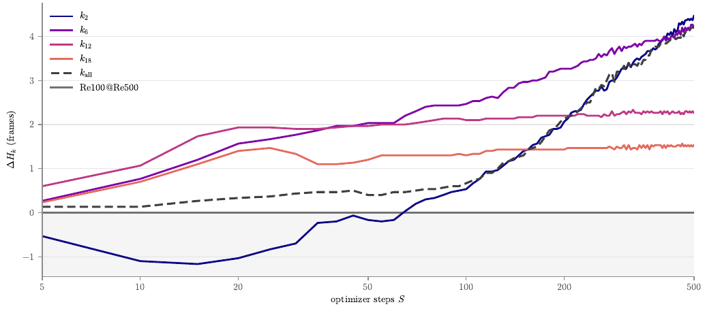
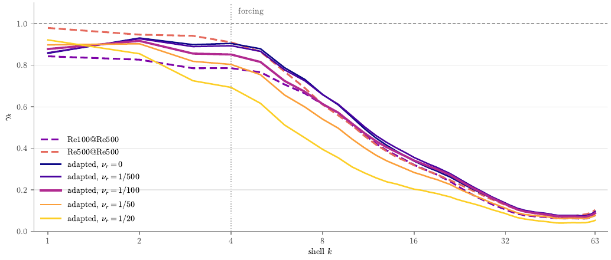

# Test-time physics-informed fine-tuning

Adapting a neural PDE surrogate to a shifted regime using only unlabeled initial
conditions and the residual of an equation whose coefficient is wrong.

## Findings

A 3D U-Net surrogate pretrained on Kolmogorov flow at Re100 is deployed at Re500 and
fine-tuned on five unlabeled initial conditions, with the source viscosity left in the
residual.

- **A misspecified residual still helps.** Adaptation lengthens the prediction horizon
  at every resolved scale and recovers 43% of the gap to a model trained on labeled
  Re500 data.
- **The correct viscosity adds nothing.** Putting the true target viscosity into the
  residual gives no further gain.
- **The gain needs a budget.** It appears only after more than 200 steps. Below that,
  the largest scales regress first, and the residual gives no warning.

  
  

## Run

    pip install -r requirements.txt
    python -m msc.tta.adapt.adapt experiment=unet_nu100
